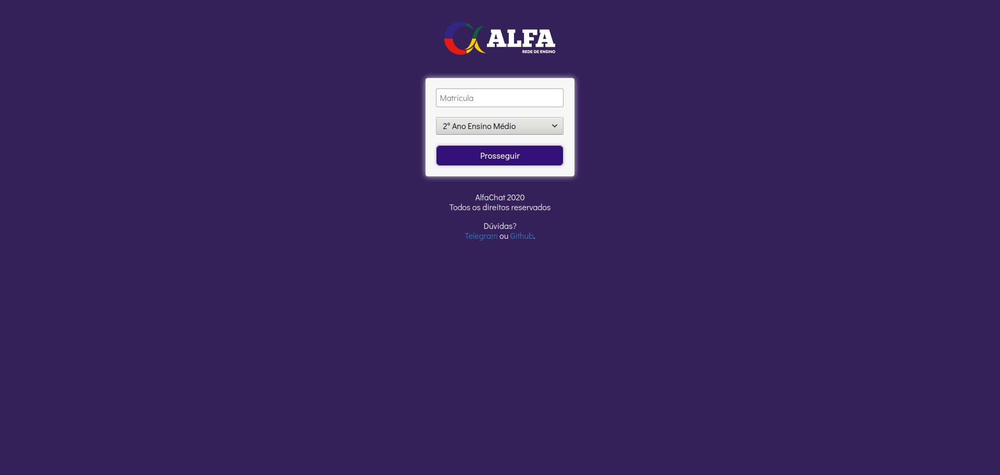
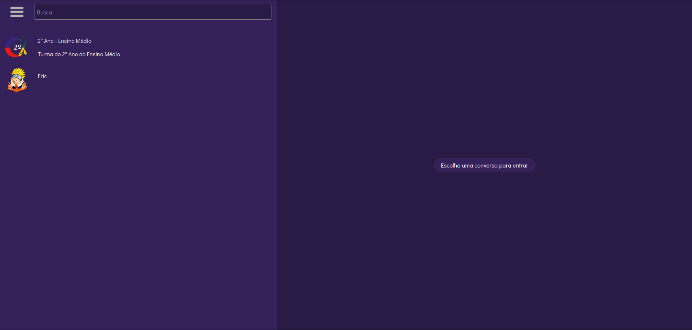
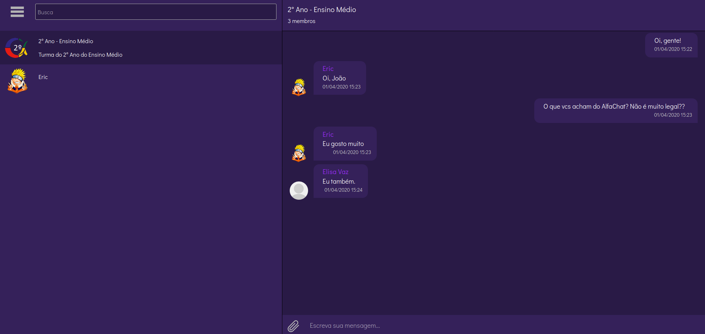
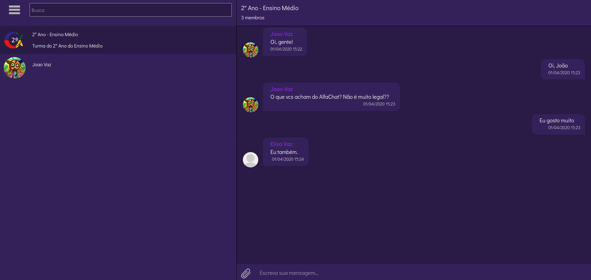
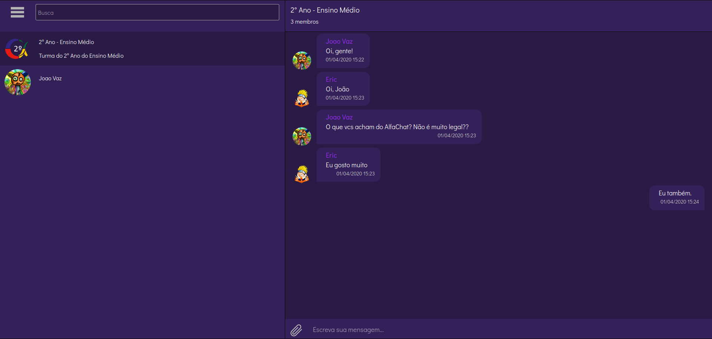
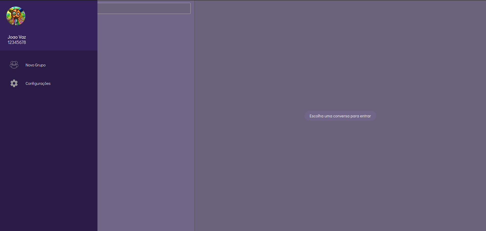
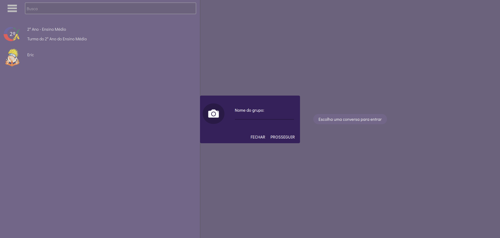
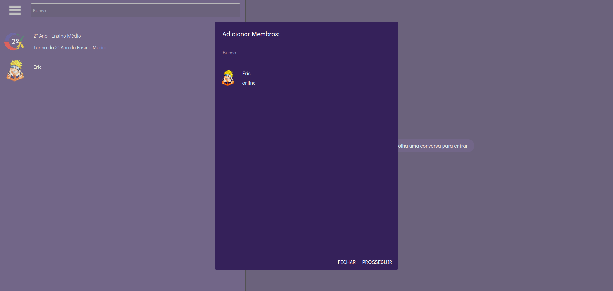
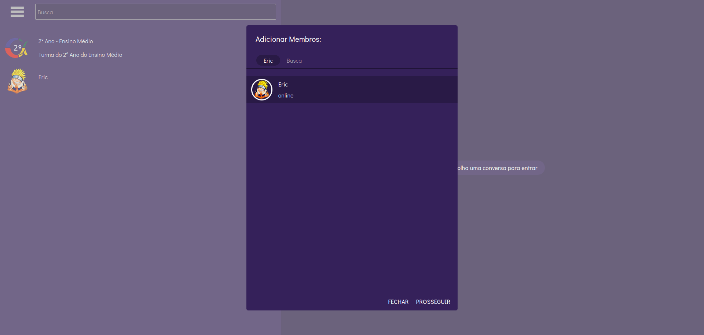

# alfachat
O AlfaChat &eacute; a rede social que permite que alunos do col&eacute;gio Alfa se comuniquem com seus professores, para tirar d&uacute;vidas e auxiliar no processo de ensino.

Para conseguir usar a ferramenta, o usu&aacute;rio precisa:
* estar matriculado em uma sede do col&eacute;gio Alfa;
* ter um n&uacute;mero RA (n&uacute;mero de matr&iacute;cula) (*);
* ter acesso &agrave; internet;
* estar disposto a turbinar seus estudos;

(*): consequ&ecirc;ncia do passo anterior

Voc&ecirc;, professor, que deseja se cadastrar, entre em contato conosco, por meio do <a href='https://t.me/bored_user' target='_blank'>Telegram</a> ou por <a href='https://github.com/bored-user/AlfaChat/issues' target='_blank'>aqui</a> mesmo!

Aqui est&atilde;o alguns exemplos da interface:  
  
  
  
  
  
  
  
  

